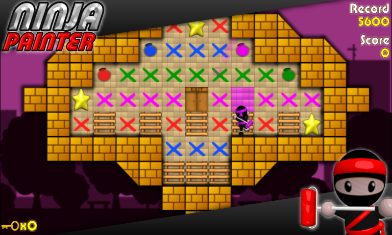

## Overview

For this programming assignment, I developed a tile-based game in C where the player controls a ninja navigating a grid-based environment. based on the game ninja painter:

{: w="500" h="400" }

The game involves collecting paint, painting tiles, unlocking exits and navigating obstacles. The board also features special mechanics such as trampolines, glass tiles and directional movement.

## Implementation

The assignment involved applying fundamental C programming concepts to develop the game logic and manage the game board.

Key concepts included:

- Two-dimensional arrays for representing the game board
- Structs and enums for managing different tile types and colours
- Pointers for tracking and updating the player's position
- Functions and modular programming
- Conditional logic and loops for implementing game mechanics
- Collision detection and movement handling
- Game state tracking and statistics

I also implemented additional mechanics such as long ladders, trampolines and special tile interactions to make the gameplay more complex.

## What I Learned

This assignment helped strengthen my understanding of C programming, particularly working with pointers, structs and multidimensional arrays.

I also gained experience breaking down a larger program into smaller functions, making the code easier to manage, test and debug.

One of the more interesting aspects was implementing the movement system and handling interactions between different tile types, especially when special mechanics such as trampolines affected the player's movement.

## Further Details

View the source code on [GitHub](https://github.com/Yuxiang-He-NZ/COMP1511/tree/main/ass1).