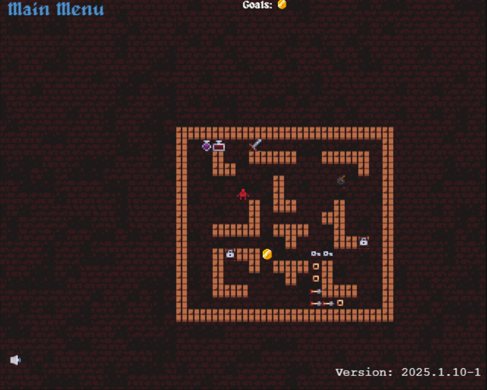
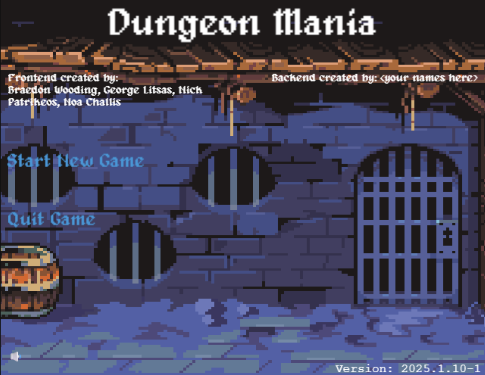

## Overview

Dungeonmania is a Java game in which the player interacts with different items and entities to find a way to escape a dungeon.

## Gameplay and Features

The game allows the player to interact with various items and entities. These interactions form the core of the gameplay and help the player progress through the dungeon.

<!-- Add specific mechanics, entity types, and game objectives here. -->

## Implementation

I developed the project in Java. It gave me the opportunity to apply object-oriented programming (OOP) concepts and work with different software design patterns.

I also gained experience refactoring code to improve its structure and maintainability.

## What I Learned

This project helped me develop my understanding of:

- Object-oriented programming
- Software design patterns
- Code refactoring
- Structuring a larger Java project

I found the project particularly interesting because I could apply these concepts while building a game.

## Project Gallery



  
  

    the actual Game
  

  
  

    The homepage frontend
  





## Further Details
View the source code on [GitHub](https://github.com/Yuxiang-He-NZ/COMP2511/tree/main/assignment-ii-part-1).