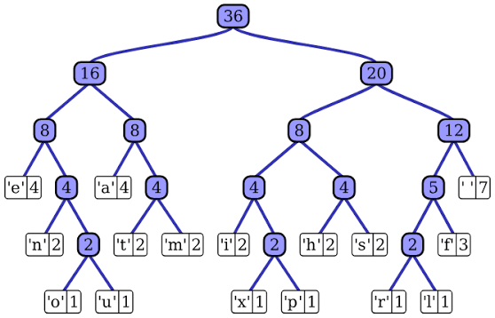

## Overview

For this algorithms assignment, I implemented the **Huffman encoding algorithm** to compress a text file.

One of the most satisfying parts was seeing how much the file size could decrease after compression.

## How It Works

Huffman encoding is a compression technique that assigns variable-length codes to symbols based on their frequencies. More frequent symbols receive shorter codes, while less frequent symbols receive longer codes like below:

{: w="500" h="400" }

## Implementation

The assignment involved applying algorithmic concepts including:

- Tree traversal
- Recursion
- Building and using a Huffman tree

## What I Learned

I enjoyed this assignment because it combined an interesting algorithm with a result that was easy to observe: the compressed file could be dramatically smaller than the original.

It also helped strengthen my understanding of tree-based algorithms and recursion. This is one of the reasons algorithms became my favourite course topic.

## Further Details

View the source code on [GitHub](https://github.com/Yuxiang-He-NZ/COMP2521/tree/main/ass1).