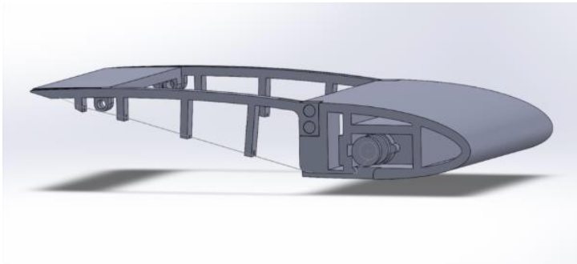
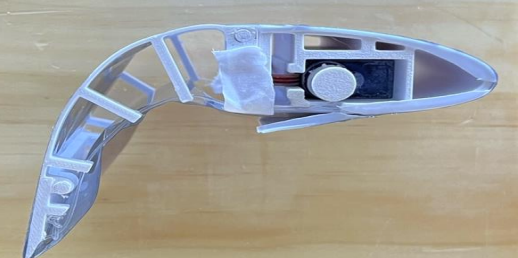
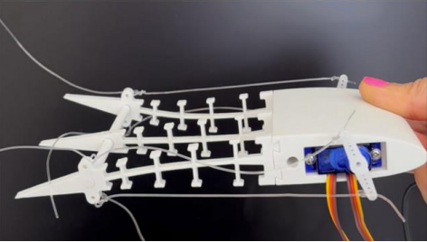
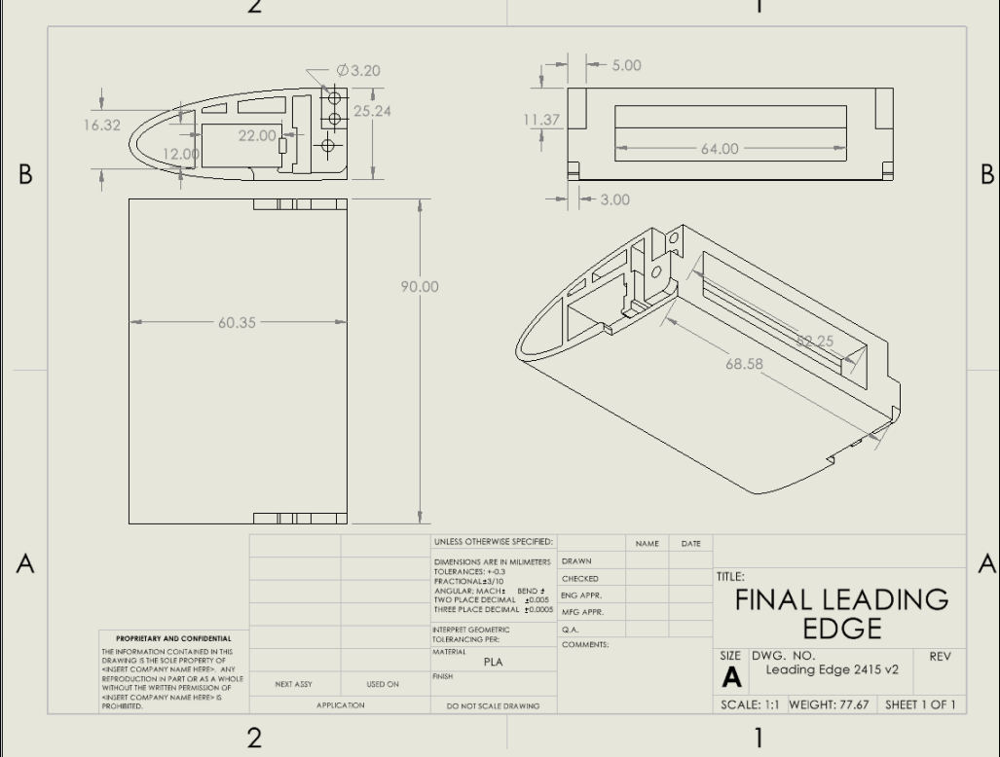

## Overview

My group designed a morphing wing that can adjust its camber as needed to generate more or less lift.

## Design and Implementation

The project involved developing a wing design with an adjustable camber. We used SolidWorks for the mechanical design and Arduino for the control side of the project.

<!-- Add an explanation of the mechanism and how the Arduino controls it. -->

## Skills Developed

This project helped me improve my SolidWorks skills and gain more experience with Arduino programming.

## Project Gallery



  
  

    Final CAD of the wing
  

  
  

    physical wing product
  

  
  

    wing prototype
  

  
  

    final CAD
  




