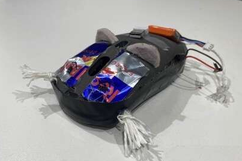
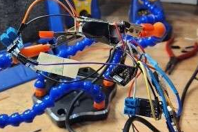
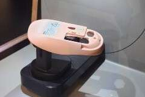

## Overview

This was a fun project I worked on with a group at the Terrible Ideas Hackathon. We built a novelty computer mouse that gives the user a small electric shock and then moves away. We also won the most technically impressive award at this hackation.

## Project Concept

The idea was to turn an intentionally terrible idea into a working prototype. Our concept combined a computer mouse with an unexpected interaction: the mouse would shock the user before making its escape. This is what made it a teriblle idea

## What I Learned

The project gave me experience working in a team and developing a prototype under the time constraint of a hackathon. It was also my first time soldering, which is cool. It was also nice to work on various parts of the project such as the scanning and testing.

## Project Gallery
Sorry the image is kinda bad :(



  
  

    Final prototype of the mouse
  

  
  

    Trying to solder the electronics
  

  
  

    Scanning the mouse to create a case
  




