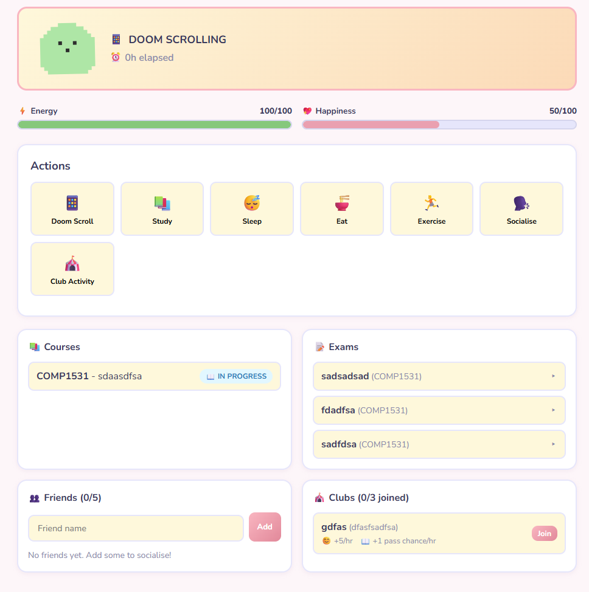

## Overview

Unigotchi is a group project inspired by the virtual-pet toy **Tamagotchi**. Players raise a pet represented inside an egg.

Our version has a university-student theme and includes multiplayer functionality, distinguishing it from the original inspiration.

## Concept and Gameplay

The central idea is to raise a virtual pet. The university theme and multiplayer aspect give the game its own identity.

<!-- Add details about pet needs, player actions, progression, and multiplayer interactions here. -->

## Implementation

The course introduced us to JavaScript and TypeScript. During the project, we also worked with:

- API requests
- Git and collaborative version-control practices
- Group software development

## Teamwork and What I Learned

Working as a group made this a particularly unique project. It gave me experience collaborating on a software project while learning new technologies and practising Git workflows.

## Project Gallery



  
  

    the final frontend
  




