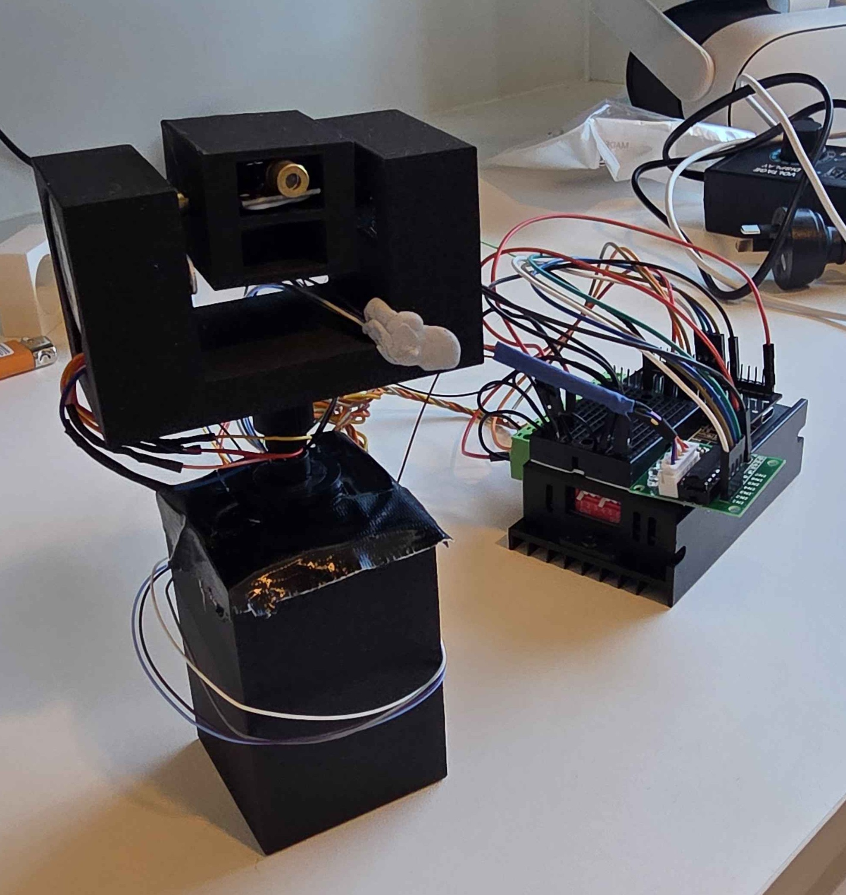
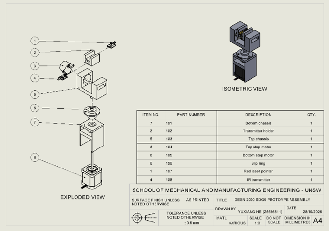
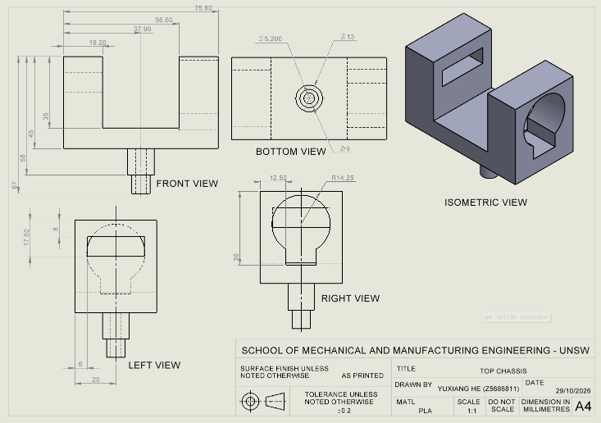

## Overview

For my DESN 2000 group project I designed the protoype for the gimble we were making.
I made the whole thing by myself this includes the soldering, heatshrink, buying of components, 3d printing, toleranceing, testing code and many others.

## Design and Implementation

The project involved developing a two axis gimble with full rotation on the bottom axis and 270 degree rotation on the top axis. We also needed to be able to control the rotations to a specific angle on both axis. There also had to be a lazer on the rotating with the top axis to demostrate the prototype.

This meant that I had to get 2 stepper motors for each axis and since there needed to be full rotation on the bottom axis a slip ring is also needed. so the wires dosent get tangled. All of this had to be wired up which caused a lot of soldering.

Cadding and 3d printing took some time as the toleranced were not good enough and some components wouldnt fit. luckily it only took 2 attemptes to get the final model.

After the prototype was assembled code also had to be written to control each axis. Which led me to get a esp32 and write up all the code to control the two stepper motors as well as the laser.

<!-- Add an explanation of the mechanism and how the Arduino controls it. -->

## Skills Developed

This project helped me im multiple ways like what I mentioned in the overview. It really helped with my manufacturing skills as I had to basically make everything myself, I realised how much more challlenging it is to make somthing in real life as compared to the CAD.

## Project Gallery



  
  

    Final product
  

  <video controls preload="metadata">
    <source src="/assets/lib/posts/2-Axis-Gimble/finalGimbleVideo.mp4" type="video/mp4">
    Your browser does not support video playback.
  </video>
  

    Final Gimble Video
  

  <video controls preload="metadata">
    <source src="/assets/lib/posts/2-Axis-Gimble/gimbleRotatingAllAxis.mp4" type="video/mp4">
    Your browser does not support video playback.
  </video>
  

    Gimble rotating on all axis
  

  
  

    Gimble assembly drawing
  

  
  

    Top V-frame CAD
  





